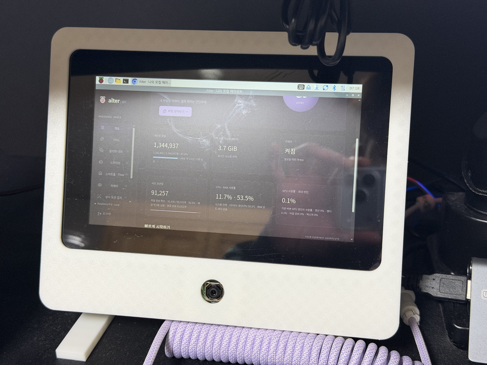
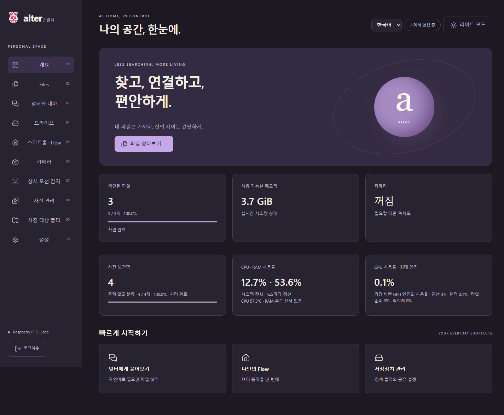
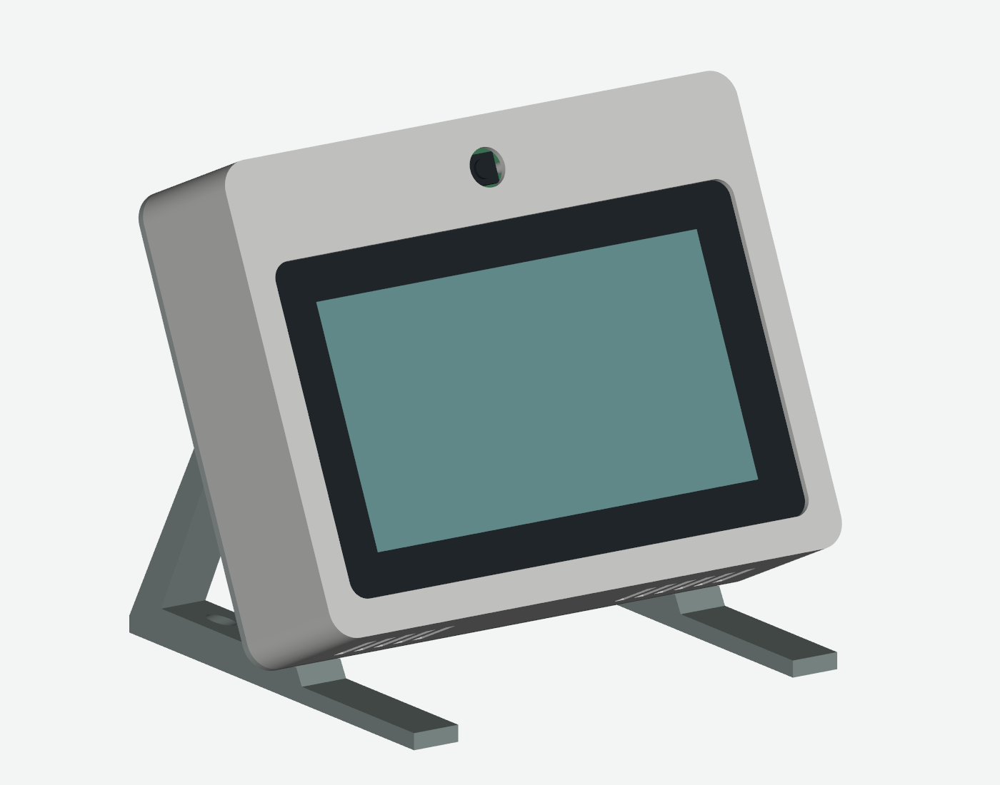

# Alter · 얼터

[English](README.md) · [한국어](README.ko.md)

라즈베리파이 5에서 실행하는 로컬 퍼스널 에이전트입니다. 파일과 사진을 찾고, SmartThings 기기를 제어하고, 직접 출력한 케이스에 터치 대시보드를 담을 수 있습니다.



위 사진은 카메라를 화면 아래에 둔 실물입니다. 아래 CAD 렌더링은 카메라가 위에 있습니다. 대시보드에서 카메라 회전과 반전을 설정할 수 있습니다.

## 주요 기능

| 기능 | 할 수 있는 일 |
|---|---|
| Files | 등록한 폴더의 트리 탐색, BM25·TF-IDF 검색, PDF·텍스트·코드·사진·영상 미리보기. HEIF·MOV 변환도 지원합니다. |
| 사진 관리 | 촬영 시점·폴더 앨범·날짜 범위 안/밖·여러 주제·이름을 붙인 얼굴 묶음으로 찾습니다. Live Photo 쌍도 연결합니다. |
| 로컬 대화 | 생성되는 답변을 바로 보고 대화별 기록을 관리합니다. 파일과 사진을 주제·저장된 사람 이름·날짜로 찾습니다. |
| 스마트홈 | 본인의 SmartThings 계정을 OAuth로 연결합니다. 기기 조작을 Flow로 저장하고 대화에서 제안한 실행을 확인합니다. |
| 카메라·모션 | 실시간 미리보기, 분할 녹화, 얼굴 존재와 다섯 손동작별 Flow. 유지 시간·재감지·대기·반복 여부를 설정합니다. |
| 터치 패널 | 큰 스마트홈 버튼, 챗봇, 한글·영문 팝업 키보드, 선택적인 한국어 음성 입력을 제공합니다. |
| 저장장치·시스템 | 파일 색인·사진 폴더·SMB 공유를 독립적으로 관리합니다. 진행률·ETA·CPU/RAM·CPU 온도·지원되는 V3D GPU 지표를 표시합니다. |

로그인 화면과 대시보드에서 한국어·영어를 선택합니다. 연보라색과 아이보리 기반의 라이트·다크 테마를 지원합니다. 언어를 바꿔도 개인 파일명·기기 이름·대화 기록은 바뀌지 않습니다.

## 실제 화면

실행 중인 앱에 별도의 예제 파일·사진·기기를 넣어 촬영한 화면입니다. [기능별 화면 보기](docs/screenshots.md).



## 직접 조립하기

기준 구성은 **Raspberry Pi 5 8GB**, 64비트 Raspberry Pi OS, **7인치 Touch Display 2**, **Camera Module 3 Standard**, 냉각 장치와 Pi 5용 전원입니다. 웹 기능만 사용할 때는 화면·카메라·마이크·외장 드라이브를 필요한 만큼 추가하면 됩니다.



[출력용 STL](hardware/enclosure/output/stl) · [편집용 STEP 조립품](hardware/enclosure/output/home_control_center_assembly.step) · [조립·체결부품·렌더링 소스](hardware/enclosure/README.ko.md)

조립 부품 12개와 시험편 2개, 총 14개 STL이며 각 부품은 220 × 220mm 출력판에 들어갑니다. 카메라가 위나 아래에 오도록 사용할 수 있으며 화면과 카메라 방향을 함께 맞춰야 합니다. 받침 체결과 케이블 경로는 선택한 배치에 맞게 확인하세요. 제공 CAD의 받침이 단순 180도 반전만으로 동일하게 조립된다는 의미는 아닙니다.

## 설치

root가 아닌 일반 Pi 데스크톱 계정에서 실행합니다.

```sh
git clone https://github.com/jeongwoo-gobroad/hw-agent.git ~/hw-agent
cd ~/hw-agent
ALTER_LANGUAGE=ko bash scripts/install.sh
```

새 대시보드 계정과 내부망 대역을 입력하면 세션 키를 생성하고 현재 Linux 계정에 맞춰 서비스를 구성합니다. 공용 비밀번호·터널 주소·SmartThings 계정은 제공하지 않습니다.

`http://<pi-host>:11977`로 접속하세요. **드라이브**와 **사진 대상 폴더**에서 폴더를 각각 등록합니다. 모델·SMB·터치 패널·음성·시작 복구의 자세한 설정은 [설치 안내](docs/setup.ko.md)를 따릅니다.

```sh
bash scripts/install-llm.sh       # 선택: 로컬 대화 모델
bash scripts/install-startup.sh   # 부팅 서비스와 바탕화면 진입점
```

기존 설치는 비공개 상태를 백업한 후 갱신합니다. `.env`, `data/`, `models/`를 예제 파일로 덮어쓰지 마세요. [업데이트와 복구](docs/operations.md).

## ngrok으로 SmartThings 연결하기

**각 설치자의 ngrok 계정과 SmartThings OAuth 앱**을 사용합니다. 설정 도우미가 자격증명을 로컬에 저장하고 해당 설치의 HTTPS 콜백을 연결합니다.

```sh
.venv/bin/python scripts/configure.py --smartthings --lang ko
bash scripts/install-ngrok.sh
sudo systemctl restart alter alter-oauth
```

먼저 [OAuth 안내](docs/oauth.ko.md)에 따라 앱을 등록하세요. ngrok 무료 개발 도메인으로 HTTPS를 제공할 수 있지만 사용량 제한이 있습니다. **SmartThings API의 요금제·국가 조건은 별도입니다.** 2026년 11월 4일부터 새 OAuth 앱 등록·수정에는 지원되는 유료 요금제가 필요합니다. [삼성의 공식 정책](https://blog.smartthings.com/smartthings-updates/smartthings-api-additional-details-for-developers-and-business-partners/)을 확인하세요.

## 모델과 한계

기본 모델은 **Qwen3.5-4B-Q4_K_M**, 실행기는 **llama.cpp CPU/OpenBLAS**입니다. 다른 서비스가 함께 실행되는 Pi 5에서 128토큰 생성 3회 평균 1.67 tokens/s를 측정했습니다. Vulkan은 모델 적재 후 시험 제한 시간 내 예열을 완료하지 못해 기본 추론에 사용하지 않습니다. [모델 출처와 시험 조건](docs/models.md).

사진 주제는 CLIP, 얼굴 묶음은 YuNet/SFace를 사용합니다. 잘못된 주제와 얼굴 묶음은 화면에서 수정할 수 있습니다. 대화의 사진 검색은 저장된 메타데이터를 조회하며 자유로운 시각 질의응답은 아닙니다. 음성은 현재 whisper.cpp의 한국어 전사이며 마이크가 필요합니다. 인식률·냉각·속도는 설치 환경에 따라 달라집니다.

## 데이터와 접속

- SQLite에 작업 위치와 해시를 보관합니다. 재시작하면 작업을 이어서 진행하고 변경 없는 추출·주제·얼굴 결과를 재사용합니다.
- 원본은 드라이브에 남고 로컬 모델 서비스에 외부 업로드하지 않습니다. SmartThings는 삼성 클라우드를 사용하며 ngrok을 켜면 요청한 웹 데이터가 ngrok을 경유합니다.
- **11977**은 설정한 내부망과 온디바이스 패널용입니다. **8080**은 비밀번호·CAPTCHA·실패 차단을 적용하는 외부 진입점입니다. 인터넷 접속에는 HTTPS를 사용하세요.
- `.env`, DB, 대화, 토큰, 모델, 개인 미디어는 Git에서 제외합니다. 백업도 비공개로 보관합니다.

## 문서와 개발

[한국어 설치](docs/setup.ko.md) · [English setup](docs/setup.md) · [개발 구조 안내](readme-for-agent.ko.md) · [English contributor map](readme-for-agent.md) · [사진 관리](docs/photos.md) · [색인·접속](docs/indexing-security.md) · [검증 범위](docs/acceptance.md)

Python/FastAPI, SQLite FTS5, vanilla JavaScript, i18next, GNU gettext를 사용합니다. 직접 의존성은 `requirements.txt`, 개발 도구는 `requirements-dev.txt`에 있습니다. 번역 카탈로그와 테스트 방법은 개발 안내를 참고하세요.

## 라이선스

Alter 코드와 자체 케이스 설계는 [GPL-3.0](LICENSE)입니다. 모델 가중치·포함 라이브러리·공식 하드웨어 참조 자료·Raspberry Pi 상표에는 각각의 조건이 적용됩니다. Raspberry Pi나 삼성의 공식 제품이 아닌 독립 프로젝트입니다. [자료 출처](docs/assets.md).
