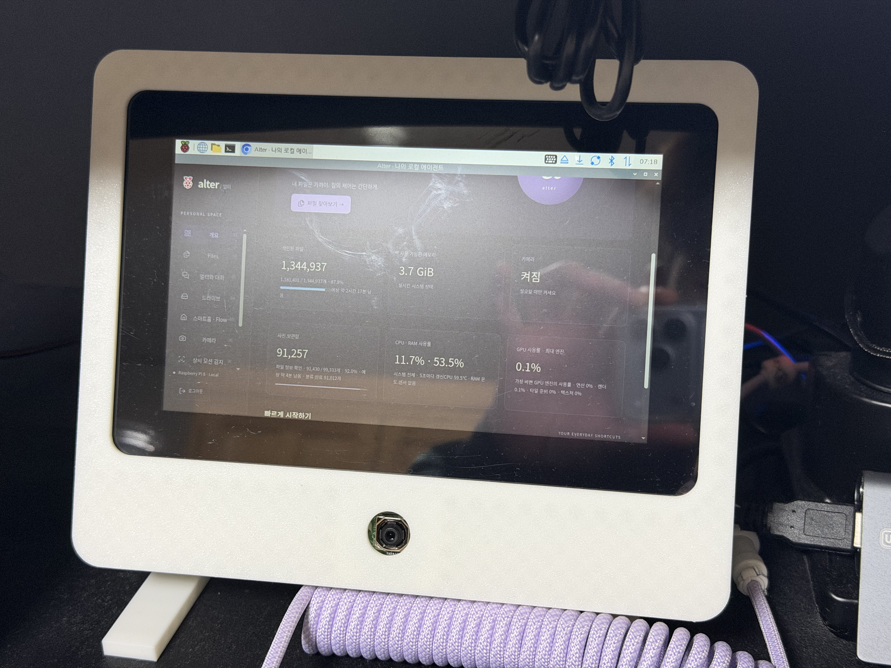
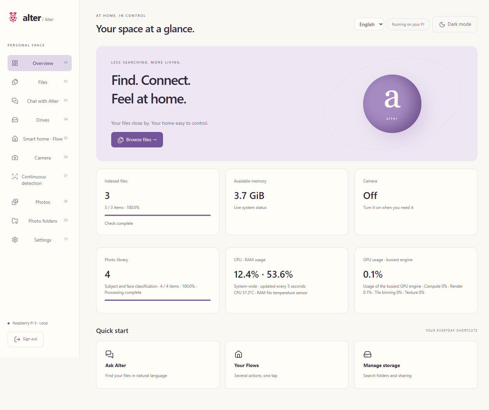
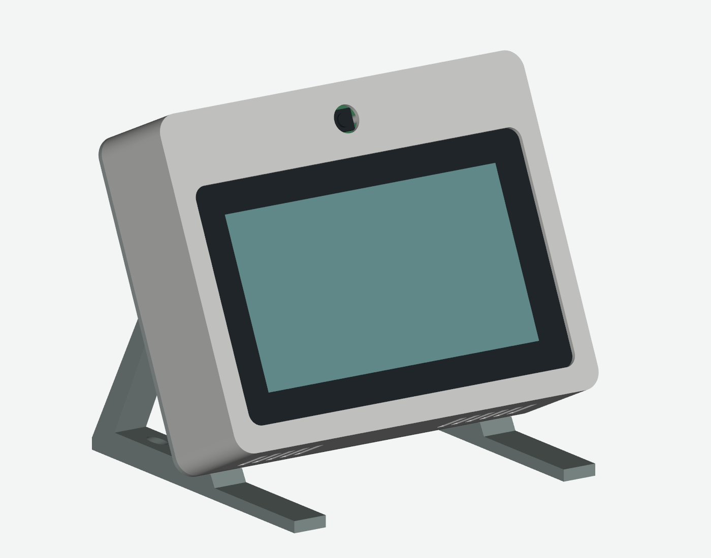

# Alter

[English](README.md) · [한국어](README.ko.md)

A local personal agent for Raspberry Pi 5. Find files and photos, control your SmartThings home, and use a touch dashboard in a printable desktop enclosure.



The photo above shows a working build with the camera below the display. The CAD render below shows the camera above it. Camera rotation and mirroring are configurable in the dashboard.

## What it does

| Feature | In daily use |
|---|---|
| Files | Browse registered folders, search with BM25 or TF-IDF, and preview PDF, text, code, images and videos, including HEIF and MOV conversion. |
| Photos | Browse a timeline and folder albums; filter capture dates inside or outside a range; search multiple subjects and named face groups. Live Photo pairs stay together. |
| Local chat | Stream replies from a local language model. Search files or photos by subject, saved person name and date; keep separate conversations. |
| Smart home | Connect your own SmartThings account through OAuth. Save device actions as Flows and confirm actions proposed in chat. |
| Camera and motion | Live preview, segmented recording, and configurable face-presence / five-hand-gesture Flow triggers with dwell, cooldown and repeat controls. |
| Touch panel | Large smart-home controls, chat, Korean/English popup keyboard, and optional Korean voice input. |
| Storage and system | Manage file-index roots, photo roots and SMB shares independently. Track progress, ETA, CPU/RAM, CPU temperature and supported V3D GPU metrics. |

English and Korean are available from the language menu on the login page and dashboard. Light and dark themes use the same lavender/ivory palette. User-owned names, filenames and chat history stay unchanged when switching language.

## In the browser

Screenshots of the running app with a separate sample library and example devices. [Browse the gallery](docs/screenshots.md).



## Build one

The reference build uses a **Raspberry Pi 5 with 8 GB RAM**, 64-bit Raspberry Pi OS, a **7-inch Touch Display 2**, **Camera Module 3 Standard**, cooling, and a suitable Pi 5 power supply. A camera, display, microphone and external drive are optional for the web-only features.



[Printable STL parts](hardware/enclosure/output/stl) · [Editable STEP assembly](hardware/enclosure/output/home_control_center_assembly.step) · [Assembly, fasteners and rendering source](hardware/enclosure/README.md)

Fourteen STL files include twelve assembly parts and two fit-test pieces. Individual parts fit a 220 × 220 mm print bed. Camera-above and camera-below layouts need matching display/camera orientation; check the stand attachment and cable routing for your chosen assembly. The provided CAD stand is not a promise of a mechanically identical 180° reversal.

## Install

Run as the normal Pi desktop account, not as root:

```sh
git clone https://github.com/jeongwoo-gobroad/hw-agent.git ~/hw-agent
cd ~/hw-agent
bash scripts/install.sh
```

The setup prompts for a new dashboard account and your trusted LAN subnet. It generates a session secret and renders service files for the current Linux account. No shared password, tunnel address or SmartThings account is provided.

Open `http://<pi-host>:11977`. Add folders separately under **Drives** and **Photo folders**. Use the [setup guide](docs/setup.md) for the optional language model, SMB, touch panel, voice and startup recovery.

```sh
bash scripts/install-llm.sh       # optional local chat model
bash scripts/install-startup.sh   # boot services and desktop entry points
```

Existing installations: back up private state before updating. Keep `.env`, `data/` and `models/`; do not replace them with example files. [Update and recovery guide](docs/operations.md).

## SmartThings with ngrok

Use **your own ngrok account and SmartThings OAuth app**. The setup helper stores credentials locally and connects the HTTPS callback to your installation; other installers do not use this project's home or credentials.

```sh
.venv/bin/python scripts/configure.py --smartthings --lang en
bash scripts/install-ngrok.sh
sudo systemctl restart alter alter-oauth
```

Follow the [OAuth setup guide](docs/oauth.md) before running these commands. ngrok's free development domain can provide HTTPS, subject to its bandwidth/request limits. **SmartThings has separate API plan and region requirements**; new or edited OAuth apps require an eligible paid plan from November 4, 2026. ngrok does not remove those requirements. See [Samsung's policy](https://blog.smartthings.com/smartthings-updates/smartthings-api-additional-details-for-developers-and-business-partners/).

## Model and limits

The default is **Qwen3.5-4B-Q4_K_M**, served by **llama.cpp on CPU/OpenBLAS**. A Pi 5 measurement with concurrent services averaged 1.67 generated tokens/s over three 128-token runs. Vulkan loaded the model but did not finish warmup within the test limits, so GPU inference is not enabled by default. [Model sources and benchmark conditions](docs/models.md).

Photo subjects use CLIP; face groups use YuNet/SFace. Labels and group assignments can be wrong and can be corrected in the UI. Chat searches stored photo metadata; it is not unrestricted visual question answering. Voice currently transcribes Korean with whisper.cpp and requires a microphone. Gesture accuracy, cooling and performance depend on the installation.

## Data and access

- File and photo jobs keep checkpoints and content hashes in SQLite. Restarting resumes work and reuses unchanged extraction, subject and face results.
- Original files stay on your drives. Local inference does not upload them to a model service. SmartThings needs Samsung's cloud; enabling ngrok sends requested web traffic through ngrok.
- Port **11977** is for the configured LAN and the on-device panel. Port **8080** is the public entry point with password login, CAPTCHA and configurable failed-login blocking. Use HTTPS for Internet access.
- `.env`, runtime databases, conversations, tokens, models and personal media are excluded from Git. Backups remain private.

## Documentation and development

[Setup](docs/setup.md) · [한국어 설치](docs/setup.ko.md) · [Architecture / contributor map](readme-for-agent.md) · [한국어 개발 안내](readme-for-agent.ko.md) · [Photos](docs/photos.md) · [Indexing and access](docs/indexing-security.md) · [Validation](docs/acceptance.md)

Python/FastAPI, SQLite FTS5, vanilla JavaScript, i18next and GNU gettext. Direct runtime dependencies are in `requirements.txt`; development tools are in `requirements-dev.txt`. See the contributor map for translation catalogs and tests.

## License

Alter code and original enclosure design are under [GPL-3.0](LICENSE). Model weights, vendored libraries, official hardware references and Raspberry Pi trademarks retain their respective terms. This is an independent project, not an official Raspberry Pi or Samsung product. [Asset credits](docs/assets.md).
