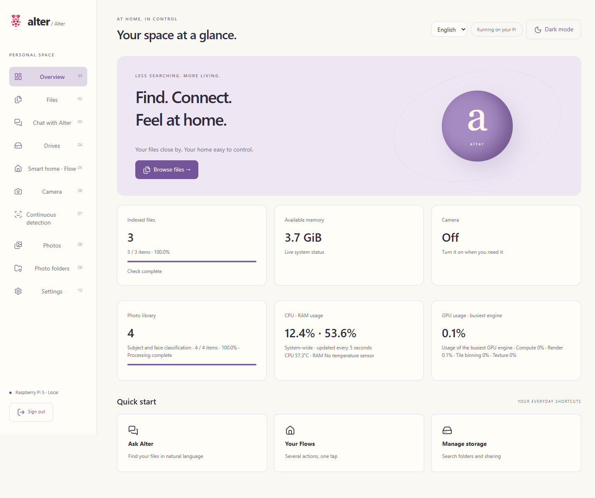
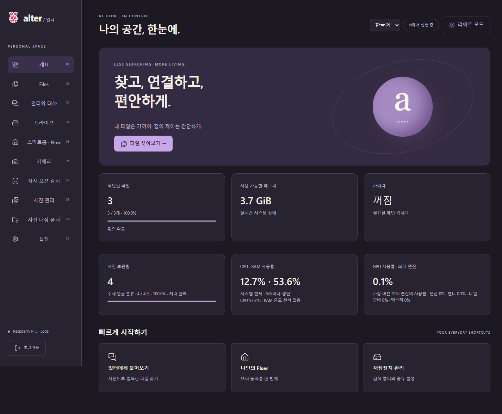
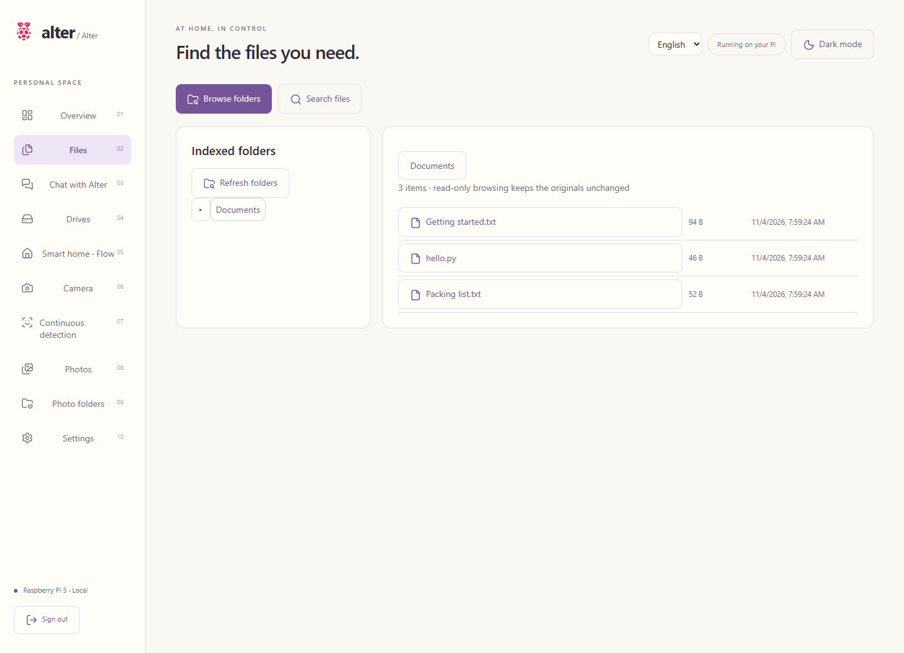
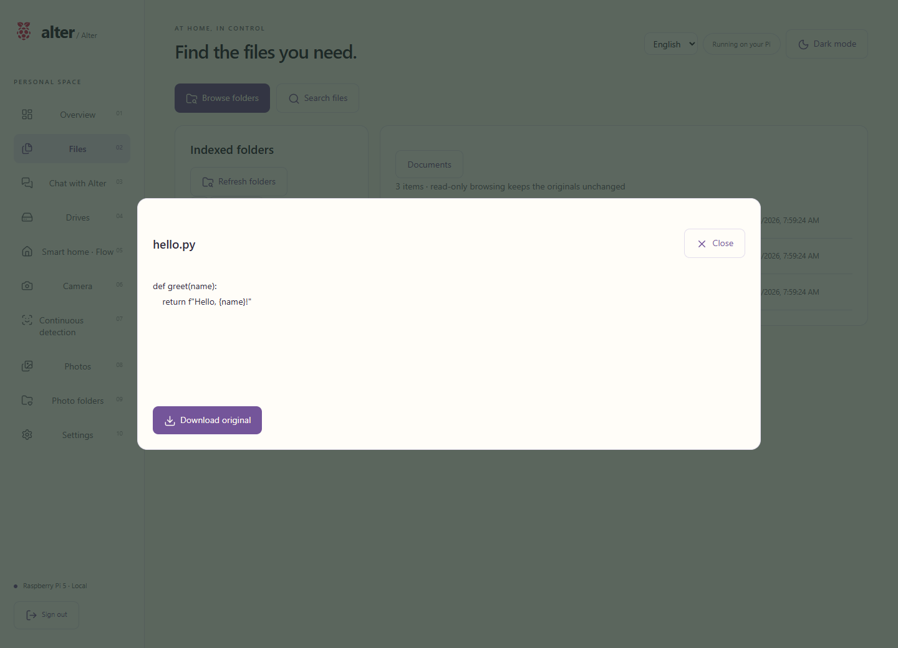
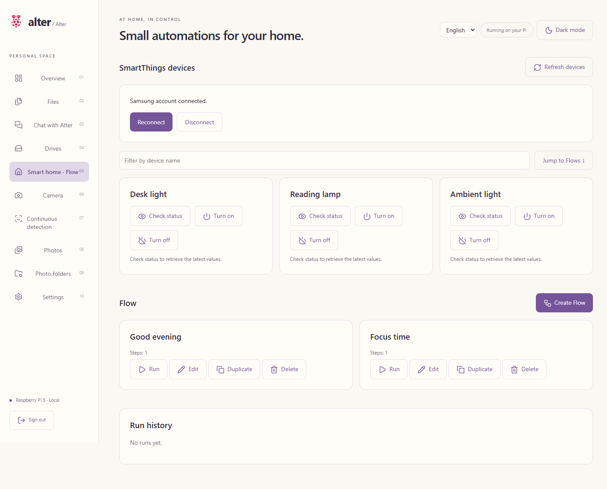
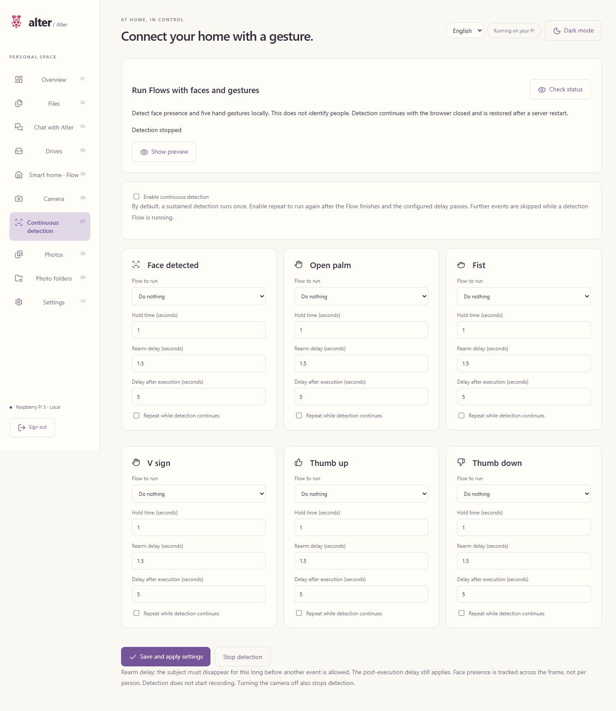
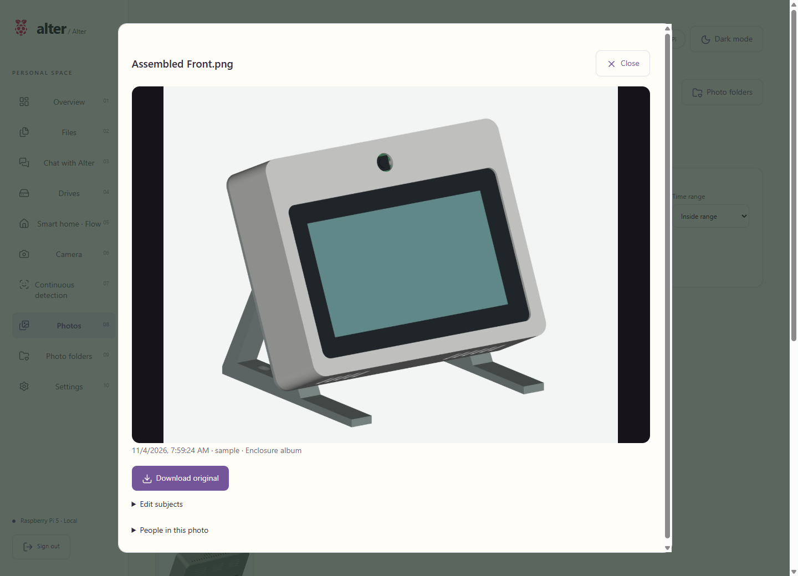
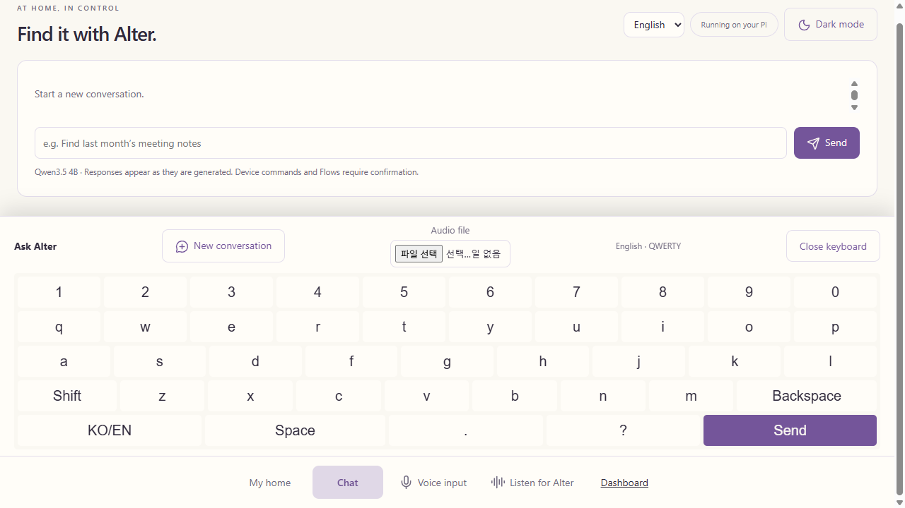
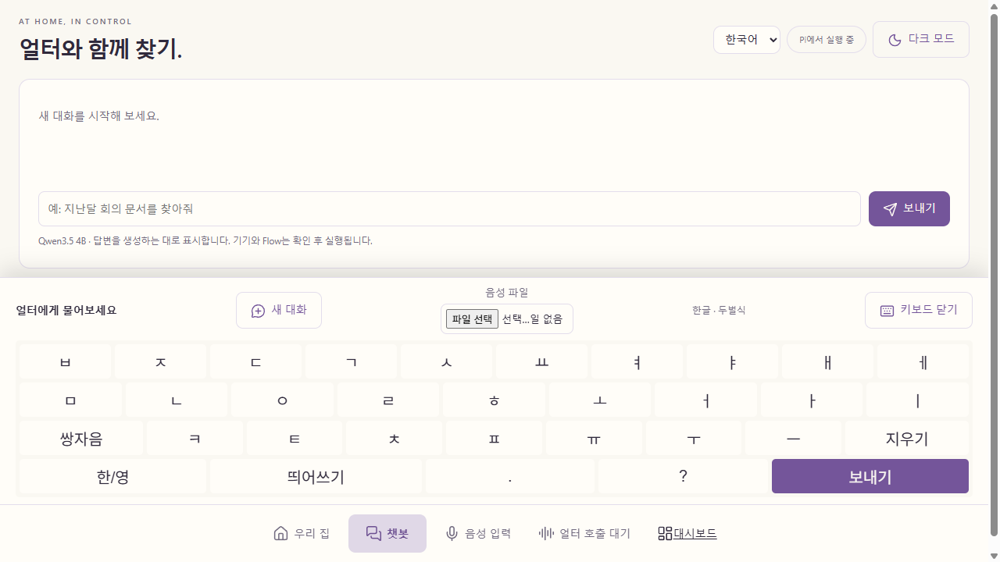

# Screenshots / 실행 화면

[English README](../README.md) · [한국어 README](../README.ko.md)

These captures use the actual application running on a Raspberry Pi, viewed in Chrome through a local SSH tunnel. The separate sample database contains three text/code files, four enclosure renders and example smart-home devices. SmartThings responses in this screenshot installation are simulated; no commands are sent to real devices. Subject labels in this dataset illustrate the UI, not classification accuracy. System meters are live. No personal library or deployment credentials were used.

라즈베리파이에서 실행한 앱을 로컬 SSH 연결을 통해 Chrome으로 촬영했습니다. 공개 화면 전용 DB에는 예제 문서·코드 3개, 케이스 렌더링 4개와 예제 기기를 넣었습니다. 이 촬영용 환경의 SmartThings 응답은 모의 응답이며 실제 기기에 명령을 전송하지 않습니다. 주제 라벨도 UI 예시이며 분류 정확도 검증 결과가 아닙니다. 시스템 계측값은 실시간 값입니다. 개인 라이브러리나 운영 인증정보는 사용하지 않았습니다.

Browser-native date and file-picker controls follow the browser/OS language. / 날짜·파일 선택처럼 브라우저가 그리는 기본 컨트롤은 브라우저·OS 언어를 따릅니다.

## Overview · English / 영어 대시보드

## Overview · Korean, dark / 한국어 다크 모드

## Files · folder browsing / 폴더 탐색

## Files · code preview / 코드 미리보기

## SmartThings and Flow / 스마트홈과 Flow

## Face and gesture triggers / 얼굴·손동작 조건

## Photos · in-browser preview / 사진 미리보기

## Touch panel · English keyboard / 영문 키보드

## Touch panel · Korean keyboard / 한글 키보드

