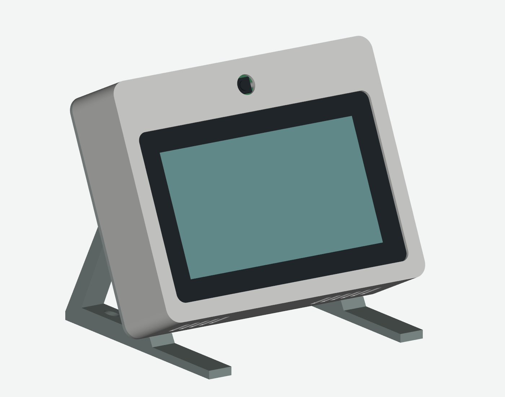
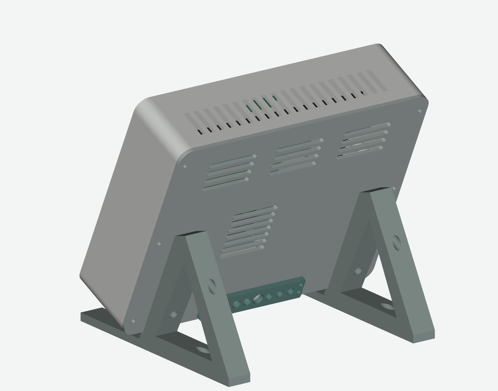
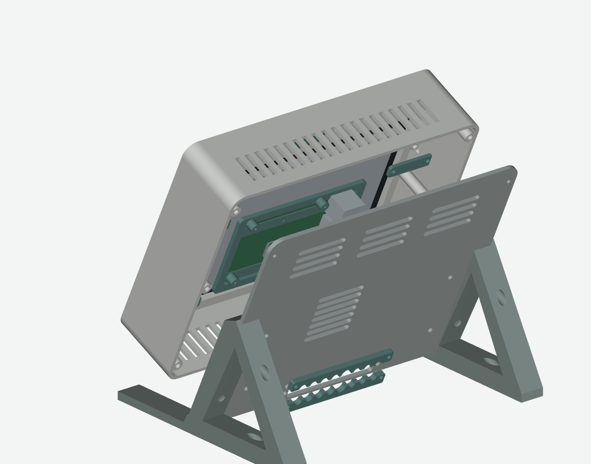

# 출력용 케이스

[English](README.md) · [한국어](README.ko.md) · [Alter](../../README.ko.md)

Raspberry Pi 5, 7인치 Touch Display 2, Camera Module 3 Standard와 공식 Pi 5 케이스의 팬을 위한 탁상형 설계입니다. Active Cooler 및 Camera Module 3 Wide는 같은 기구 구성이 아닙니다.

## 파일과 크기

[STL](output/stl)은 조립 부품 12개와 시험편 2개입니다. mm 단위이며 출력 방향의 바닥이 Z=0입니다. [개별 STEP](output/step)과 [조립 STEP](output/home_control_center_assembly.step)은 조립 좌표의 케이스 형상이며 공식 전자부품·나사는 포함하지 않습니다. `parameters.json`은 치수, `build_model.py`는 CadQuery 생성·검사, `render_preview.py`는 VTK 렌더링입니다.

몸체는 뒷판을 포함해 208 × 166 × 57mm, 케이블 가이드는 추가 4mm입니다. 책상 점유 면적은 약 208 × 170mm, 전체 높이는 약 186.45mm, 기울기는 65도입니다. 각 부품은 220 × 220mm 출력판에 들어가지만 브림과 프린터의 실제 사용 영역을 확인해야 합니다.

## 기본 v1.1 체결부품

| 부품 | 수량 | 용도 |
|---|---:|---|
| M2 × 5 | 4 | 카메라 |
| M2.5 × 4 | 4 | 디스플레이 쪽 클립 |
| M2.5 × 6 | 8 | 트레이와 Pi |
| M3 × 6 | 4 | 케이스 쪽 클립 |
| M3 × 8 | 14 | 뒷판 둘레 6, 팬 브래킷 4, 케이블 가이드 4 |
| M3 × 12 | 4 | 받침 |
| M3 열삽입 인서트, 외경 약 5mm·길이 4mm | 22 | 전면 10, 뒷판 12 |
| 얇은 완충재·미끄럼 방지 패드·케이블 타이 | 필요량 | 유리·바닥·배선 |

CAD의 인서트 홀은 4.2mm이며 인서트 외경과 같은 뜻이 아닙니다. 시험편과 판매자 권장 치수를 확인하세요. 팬 자체를 브래킷에 고정할 M2.5 관통 체결부품 또는 2.5mm 타이는 별도입니다. 실물 팬 두께로 길이를 정하며 받침 볼트 머리는 지름 6.5mm 이하여야 합니다.

## 출력·조립 순서

1. 두 시험편과 팬 브래킷을 먼저 출력합니다. 화면이 억지 끼움 없이 놓이는지 확인합니다. 나사 시험편의 다섯 홀은 4.0/4.1/4.2/4.3/4.4mm, 다른 세 홀은 1.7/2.8/3.4mm입니다.
2. 슬라이서에서 통풍구와 브리지를 보고 필요한 지지대를 추가합니다. 최대 폭은 208mm입니다. 재료·프린터별 조건이 달라 공통 인필 값을 지정하지 않습니다.
3. 전원을 분리하고 인서트·파일럿 탭 가공을 전자부품 설치 전에 끝냅니다. 가장 얕은 인서트 자리는 약 5mm이므로 긴 인서트를 그대로 쓰지 않습니다.
4. M2 × 5 네 개로 카메라를 고정합니다. 화면의 비표시 유리 테두리에 얇은 완충재를 대고 클립을 M2.5 × 4 및 M3 × 6으로 연결합니다. 유리가 휘도록 조이지 않습니다.
5. 디스플레이 중앙 58 × 49mm 장착점에 M2.5 × 6 네 개로 트레이를, 같은 볼트 네 개로 Pi를 고정합니다. 출력 지지대 높이는 6mm입니다.
6. 원래 케이스 팬을 브래킷에 고정하고 뒷판에 연결합니다. 원래 방열판·패드를 유지하며 방열판으로 바람이 향하게 하고 Pi 전용 4핀 커넥터에 연결합니다. 실물 팬 개정을 확인합니다.
7. Pi 5용 22핀 mini–15핀 standard FFC로 화면과 카메라를 연결합니다. 길이는 실측하며 200mm는 검토 출발점입니다. 화면 전원은 공식 5V/GND 안내를 따릅니다. FFC를 넓게 굽히고 팬·커넥터에 끼우지 않습니다.
8. 뒷판과 받침, 미끄럼 방지 패드를 연결합니다. 분할 가이드를 케이블 주위에서 조립하고 정비 여유와 커넥터 장력을 확인합니다. 책상에서 안정성을 확인한 후 전원을 켭니다.

## 카메라 위치

CAD는 카메라가 위, [실물 사진](../../docs/images/alter-device.png)은 아래입니다. Alter 설정에서 0/90/180/270도 회전·좌우/상하 반전을 지정하면 미리보기·인식·녹화에 적용됩니다. 디스플레이 회전은 OS에서 따로 맞춥니다. 받침 체결부는 단순 180도 회전에 대칭이 아니므로 해당 방향의 체결·배선·지지를 확인하거나 조정해야 합니다.

## 선택 사항: 관통 체결 변경

이미 출력한 부품에는 뒷판 인서트 자리 10곳을 3.4mm 관통 홀로 바꾸는 변경안이 있습니다. A 받침 위쪽 2곳은 M3 × 20, B 케이블 가이드 4곳은 M3 × 16과 너트(간격 6.5mm라 와셔 제외), C 팬 브래킷 4곳은 M3 × 16과 와셔·너트입니다. D 받침 아래 2곳은 타이 고정부와 간섭하므로 인서트를 유지합니다.

총 볼트 38개, 너트 10개, 와셔 6개, 인서트 12개입니다. 기본 표에서 M3 × 8은 6개, M3 × 12는 2개로 줄이고 M3 × 16 8개와 M3 × 20 2개를 추가합니다. 나머지는 같습니다. [검사 결과](retrofit/validation.json)와 [가공 후 STEP](retrofit/rear_cover_after_drilling.step)을 참고하세요. STL은 원래 인서트 설계입니다. 파일명만 보고 가공하지 말고 STEP의 해당 위치를 확인합니다.

## 재생성·검증 범위

STL 출력에는 Python이 필요 없습니다. 편집은 별도 Python 3.12 가상환경에서 `pip install -r requirements.txt` 후 `download_references.py`, `build_model.py`, `render_preview.py`, `check_retrofit.py` 순서로 실행합니다. `--skip-reference-check`는 공식 부품 대조를 생략하며 보고서에도 기록됩니다.

[부품 검사](output/part_manifest.json)와 [간섭 검사](output/validation.json)는 CAD·메시 검증입니다. 임의 확대·축소나 큰 치수 변경은 체결 간격을 바꾸므로 재검증해야 합니다. 실제 출력 강도·유리 압력·배선·공차·전도·장시간 냉각을 보증하지 않습니다. 조립해 작동하는 예시는 제공하지만 원래 CAD 보고서의 실물 시험 여부를 소급 변경하지 않습니다.
