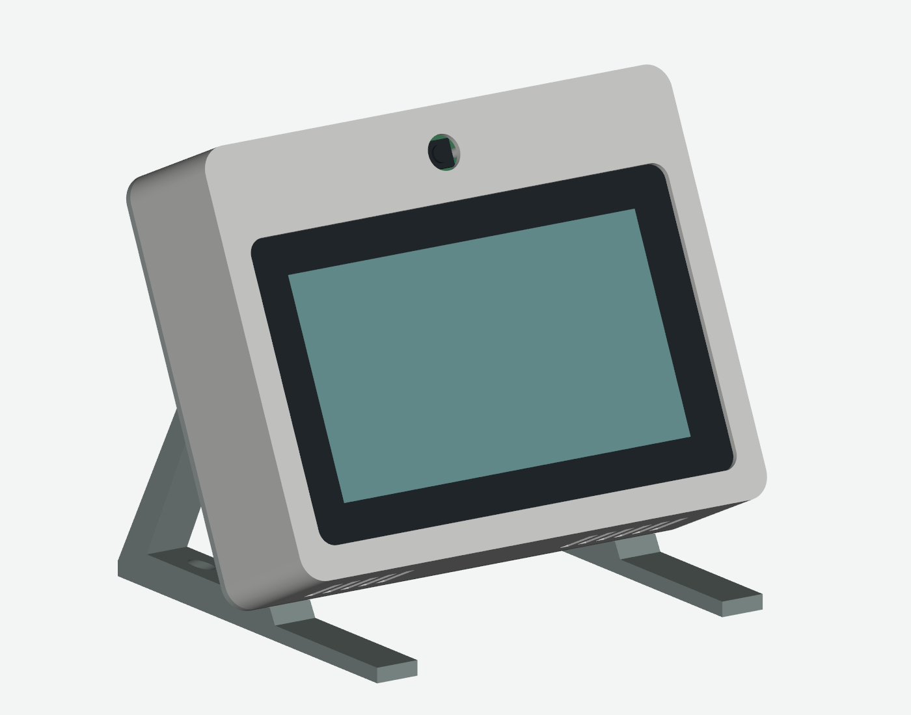
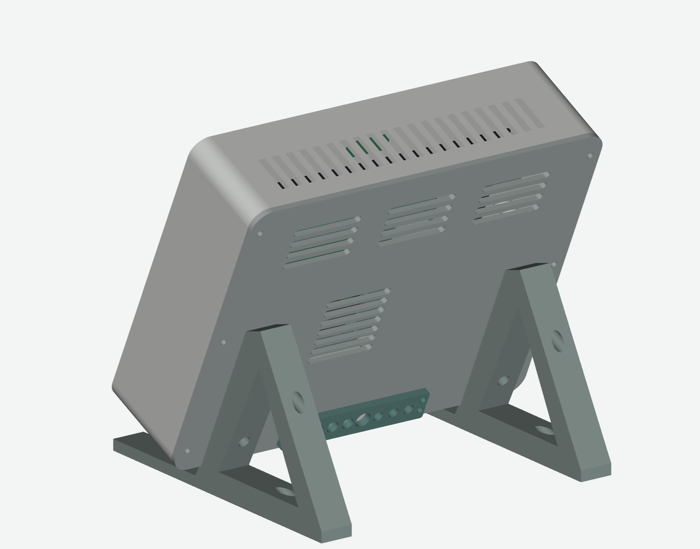
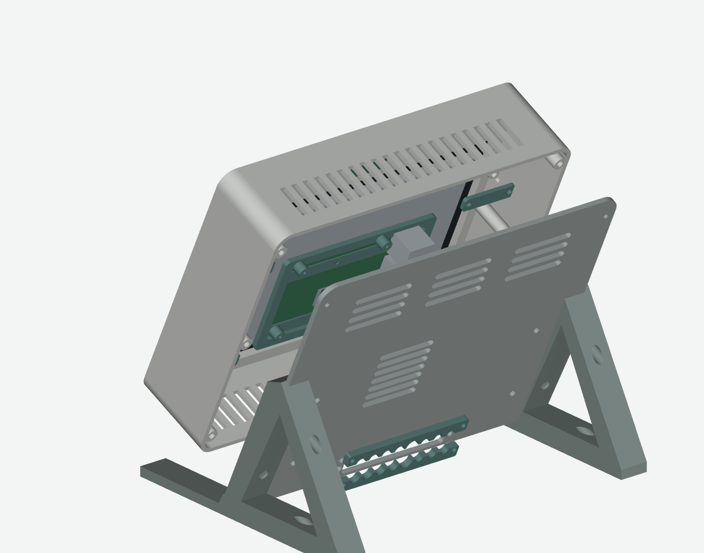

# Printable enclosure

[English](README.md) · [한국어](README.ko.md) · [Alter](../../README.md)

Desktop enclosure for Raspberry Pi 5, the 7-inch Touch Display 2, Camera Module 3 Standard and the fan from the official Pi 5 case. The Active Cooler and Camera Module 3 Wide are not the same mechanical configuration.





## Files and dimensions

- [STL](output/stl): 12 assembly pieces + 2 fit coupons, millimetres, oriented for printing with their base at Z=0.
- [Individual STEP](output/step) and [assembled STEP](output/home_control_center_assembly.step): editable enclosure solids, in assembly coordinates. The assembly excludes official electronics and screws.
- `parameters.json`, `build_model.py`, `render_preview.py`: dimensions, CadQuery construction/checking and VTK renders.
- [Part manifest](output/part_manifest.json), [CAD checks](output/validation.json): mesh bounds, solids, watertightness and intersection results. These checks do not certify physical strength or cooling.
- `reference/sources.json` and `fan_sources.json`: reference URLs, hashes and provenance. Original vendor CAD is downloaded separately.

Body: 208 × 166 × 57 mm including the rear lid, with a further 4 mm cable guide. Desktop footprint: about 208 × 170 mm; total height about 186.45 mm; display angle 65°. Each part fits a 220 × 220 mm print bed; verify the printer's usable area and brim size.

## Parts and fasteners — original v1.1

| Item | Quantity | Use |
|---|---:|---|
| M2 × 5 | 4 | Camera PCB |
| M2.5 × 4 | 4 | Display-side clips |
| M2.5 × 6 | 8 | Display-to-tray and Pi-to-tray |
| M3 × 6 | 4 | Shell-side clips |
| M3 × 8 | 14 | Rear perimeter 6, fan bracket 4, cable guide 4 |
| M3 × 12 | 4 | Two stand halves |
| M3 heat-set inserts, about 5 mm OD × 4 mm long | 22 | Shell 10, rear cover 12 |
| Thin cushioning, non-slip feet, cable ties | As needed | Glass support, desk grip and cable routing |

The insert bore is 4.2 mm in the CAD; it is not the insert's outside diameter. Print the fastener coupon and match your insert manufacturer's requirements. Fan-to-bracket M2.5 through-fasteners or 2.5 mm ties are additional; choose screw length after measuring the actual fan. Stand screw heads must be at most 6.5 mm in diameter.

## Print and assemble

1. Print both coupons and the fan bracket first. Verify the glass can sit without being forced and test the insert holes. The five-hole coupon row is 4.0/4.1/4.2/4.3/4.4 mm; the other row is 1.7/2.8/3.4 mm.
2. Inspect bridges/vents in the slicer and add support where necessary. The largest part is 208 mm wide; on a 220 mm bed keep brim and edge exclusion in mind. Print parameters depend on material and printer; no universal infill setting is specified.
3. Disconnect all power. Install inserts and tap the camera/tray pilot holes before adding electronics. The shallowest insert pocket is about 5 mm deep; do not substitute a longer insert without checking.
4. Mount the camera with four M2 × 5 screws. Place thin cushioning on the non-active glass border, seat the display and attach the four clips with M2.5 × 4 and M3 × 6 screws. Do not bend or clamp the glass excessively.
5. Mount the offset tray to the display's 58 × 49 mm pattern with four M2.5 × 6 screws, then mount the Pi with four more. The printed standoffs are 6 mm high.
6. Attach the original case fan to its bracket, then attach the bracket to the rear cover. Keep the original heatsink/pad; direct airflow toward it and use the Pi's dedicated four-pin fan connector. The fan envelope includes manufacturer tolerances, but verify your actual revision.
7. Connect the display and camera using Pi 5-compatible 22-pin mini to 15-pin standard FFC cables. Measure cable reach; a nominal 200 mm cable is only a starting point. Follow the official display 5V/GND wiring guide. Keep FFC bends broad and clear of the fan and connectors.
8. Close the rear cover, attach the stand and fit non-slip feet. Install the split cable guide around the cables; it need not pass over connectors. Leave service slack, avoid tension at PCB connectors, and check stability before powering on.

## Camera above or below

The CAD render shows the camera above the display; the [working device photo](../../docs/images/alter-device.png) shows it below. Alter supports 0/90/180/270° camera rotation and horizontal/vertical mirroring for preview, detection and recording. Set display orientation separately in the OS. The stand attachment is not symmetric under a simple 180° reversal: verify or adapt the mounting, cable routing and support for the intended orientation.

## Optional through-bolt retrofit

For already printed parts, `check_retrofit.py` evaluates ten rear-cover insert positions changed to 3.4 mm through-holes. A: two upper stand positions use M3 × 20; B: four cable-guide positions use M3 × 16 without washers (6.5 mm spacing); C: four fan-bracket positions use M3 × 16 with washers; D: the two lower stand positions retain inserts to avoid the cable-tie mounts.

This alternative uses 38 bolts total, 10 nuts, 6 washers and 12 inserts. Relative to the original BOM, M3 × 8 becomes 6, M3 × 12 becomes 2, and add eight M3 × 16 plus two M3 × 20. All other bolt sizes stay unchanged. See [retrofit CAD checks](retrofit/validation.json) and [drilled rear-cover STEP](retrofit/rear_cover_after_drilling.step). Existing STL files remain the original insert design. Do not drill by filename alone: inspect the STEP and corresponding fastening location first.

## Rebuild

Printing the supplied STL does not require Python. For editing, use a separate Python 3.12 environment:

```sh
python -m venv .venv
# Activate the environment for your operating system.
pip install -r requirements.txt
python download_references.py
python build_model.py
python render_preview.py
python check_retrofit.py
```

`--skip-reference-check` on the builder explicitly skips vendor-model collision checks. The report records that omission. Geometry has fixed mounting relationships; arbitrary scaling or large parameter changes need code changes and a new fit check. Flexible cables, exact threads, printer shrinkage, long-term thermal performance and stability need physical verification. A working assembled example is shown, but the original CAD validation flags remain an honest record of CAD-only checks.
